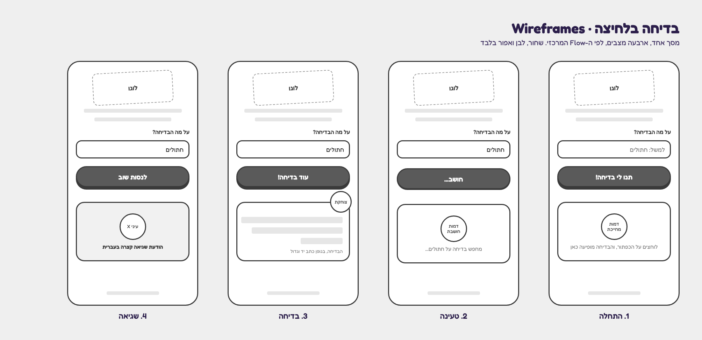

# DESIGN: בדיחה בלחיצה

## תמונות הייחוס

## הקבצים בתיקיית assets
התיקייה assets נשארת בשורש הפרויקט, ולא עוברת ל-spec. משתמשים בקבצים כמו שהם, בלי לצייר אותם מחדש.

| הקובץ | מה הוא |
|---|---|
| logo.svg | הלוגו: "בדיחה" באותיות צבעוניות קופצות, ו"בלחיצה" על מדבקה אדומה |
| mascot-idle.svg | הדמות מחייכת. מצב התחלה |
| mascot-think.svg | הדמות חושבת. מצב טעינה |
| mascot-joke.svg | הדמות צוחקת. מצב בדיחה |
| mascot-error.svg | הדמות מסוחררת. מצב שגיאה |
| bg-dots.svg | נקודות הקומיקס של הרקע, אריח של 16 על 16 |
| bg-doodles.svg | הקישוטים בקצוות העליונים של המסך |
| icon.svg, icon-maskable.svg | המקור של אייקון האפליקציה |
| icon-192.png, icon-512.png, icon-512-maskable.png | אייקוני ה-PWA |

## 1. Screens

### המסך הראשי
- המטרה: לקבל בדיחה על נושא, בלחיצה אחת.
- מה יש במסך, מלמעלה למטה:
  - הלוגו, assets/logo.svg, במרכז, ברוחב 300.
  - שורת הסבר במרכז: "כותבים נושא, לוחצים, וצוחקים. בלי נושא, מקבלים בדיחה כללית."
  - תווית "על מה הבדיחה?" ותיבת טקסט, עם הטקסט המציין "למשל: חתולים". עד 100 תווים.
  - הכפתור הגדול: "תנו לי בדיחה!", ברוחב מלא, אדום.
  - בועת הבדיחה, ובתוכה הדמות: כפתור אדום עם פרצוף.
  - בתחתית המסך: "מיישם AI ואוטומציה · 53500", קטן ובדיו רך.
- מה קורה במסך, בארבעה מצבים. לכל מצב ציור אחר של הדמות:
  1. התחלה: הדמות מחייכת, mascot-idle, במרכז הבועה. מתחתיה: "לוחצים על הכפתור, והבדיחה מופיעה כאן". הכפתור: "תנו לי בדיחה!".
  2. טעינה: הכפתור לחוץ למטה, נעול, וכותב "חושב...". הדמות חושבת, mascot-think, ונמעכת. הטקסט: "מחפש בדיחה על [הנושא]...", או "מחפש בדיחה..." כשאין נושא.
  3. בדיחה: הדמות הצוחקת, mascot-joke, קופצת לפינה הימנית העליונה של הבועה, חצי בחוץ. הבדיחה בכתב יד, בגודל 25. הכפתור: "עוד בדיחה!".
  4. שגיאה: רקע הבועה ורדרד, הדמות מסוחררת, mascot-error, והודעה קצרה באדום. הכפתור: "לנסות שוב".

### ניווט בין המסכים
אין. יש מסך אחד, והמצבים מתחלפים בו. בהתקנה כ-PWA האפליקציה נפתחת ישר למסך הזה, במסך מלא.

## 2. Style Guide

### צבעים
| שם | HEX | שימוש |
|---|---|---|
| שמש | #FFE15A | רקע המסך |
| נייר | #FFFFFF | התיבה והבועה |
| דיו | #2B1E4A | טקסט, קווי מתאר וצללים. 11.7:1 על השמש, 15.1:1 על הנייר |
| דיו רך | #4A3D6B | שורת ההסבר, הודעות משניות והתחתית. 7.5:1 על השמש |
| אדום | #F23D2F | הכפתור הגדול. טקסט לבן, 3.8:1, מספיק לטקסט מודגש בגודל 24 |
| כחול | #2E9BFF | אות בלוגו, טבעת הפוקוס |
| ורוד | #FF5FA8 | אות בלוגו, קישוט |
| מנטה | #1FCB8C | אות בלוגו, קישוט |
| סגול | #8B5CF6 | אות בלוגו, קישוט |
| שגיאה | #C0261B | טקסט שגיאה, 5.1:1 על ורוד השגיאה |
| ורוד שגיאה | #FFE8EC | רקע הבועה במצב שגיאה |
| רמז | #756B92 | הטקסט המציין בתיבה, 4.9:1 על הנייר |

### גופנים
- שני גופנים מ-Google Fonts, עם גיבוי ל-system-ui:
  - Fredoka, במשקלים 500, 600 ו-700, לכל הממשק.
  - Playpen Sans Hebrew, במשקל 500, רק לבדיחה עצמה. זה כתב יד, וזה מה שהופך את הבדיחה למצחיקה יותר.
- כפתור 24 במשקל 700. תיבה 19 במשקל 500. תווית 18 במשקל 600. הסבר 17 במשקל 500. בדיחה 25, בריווח שורות 1.55. תחתית 13.

### כפתורים ורכיבים
- הכפתור הגדול: גלולה, גובה 64 לפחות, רוחב מלא. אדום, מסגרת 3 בצבע הדיו, וצל קשה של 8 פיקסלים מתחתיו. מסובב מעלה אחת. בלחיצה ובזמן טעינה הוא יורד 6 פיקסלים, והצל מתקצר ל-2.
- תיבה: פינות 18, מסגרת 3 בצבע הדיו, צל קשה 4 על 4, מסובבת 0.6 מעלות. בפוקוס: טבעת כחולה בעובי 4.
- בועה: פינות 28, מסגרת 3, צל קשה 6 על 6, מסובבת 1.2- מעלות, גובה מינימלי 190.
- הדמות: ברוחב 118, במרכז הבועה. במצב בדיחה ברוחב 86, בפינה, מסובבת 8 מעלות.
- אזור הבדיחה מודיע לקורא מסך כשהתוכן משתנה (aria-live).

### פינות, צורות ומרווחים
- מרווחים: 14 בין רכיבים, 18 בצדי המסך, ורוחב תוכן מקסימלי 440.
- צללים: רק צללים קשים בצבע הדיו, בלי טשטוש.
- רקע: bg-dots.svg חוזר על כל המסך, ו-bg-doodles.svg מופיע פעם אחת למעלה, במרכז. הקישוטים רק בקצוות, רחוק מהטקסט.

### תנועה
- התחלה: הדמות קופצת 5 פיקסלים, במחזור של 2.4 שניות.
- טעינה: הדמות נמעכת ל-86% ומשתחררת, כל חצי שנייה.
- בדיחה: הדמות מתגלגלת מצחוק ארבע פעמים, ונעצרת.
- שגיאה: הדמות מתנדנדת פעמיים.
- מי שביקש בטלפון פחות תנועה (prefers-reduced-motion): בלי תנועה בכלל.

### אווירה כללית
שובב, צבעוני וקצת מטופש, כמו מדבקות של קומיקס. שום דבר לא ישר לגמרי. הצבעוניות בלוגו, בכפתור ובקישוטים, והטקסט נשאר כהה וקריא.
